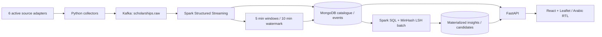

# خريطة المنح — Scholarship Map

موقع عربي للبحث عن المنح على خريطة تفاعلية، مع توصيات مفسّرة حسب الجنسية والمعدل والتخصص والمرحلة والدول المفضلة. يمكن تصفّح الموقع قبل إدخال أي معلومات، ولا يحتاج حسابًا.

المشروع يجمع بين **React + Leaflet + FastAPI** ومسار بيانات حقيقي: **Kafka → Spark Structured Streaming → MongoDB**. يستخدم Spark SQL للتحليلات وMinHash LSH لاكتشاف إعلانات متشابهة، مع مقارنة فعلية بالطريقة الدقيقة. لا يستخدم Bloom Filter.

## التشغيل على جهاز Windows الحالي

من PowerShell 7 داخل مجلد المشروع:

```powershell
cd C:\Users\pc\IdeaProjects\ScholarshipMap
.\scripts\Start-Project.ps1
```

افتح [الموقع العربي](http://127.0.0.1:8000/) أو [توثيق API التفاعلي](http://127.0.0.1:8000/docs). لتشغيل المشروع لأول مرة على جهاز آخر، ثبّت Python 3.12 أو 3.13 وNode.js 24 وPowerShell 7 ثم نفّذ:

```powershell
.\scripts\Setup-Project.ps1
.\scripts\Start-Project.ps1
```

الإعداد ينزّل Java 21 وKafka وMongoDB إلى `.runtime` داخل المشروع، دون تثبيت خدمات نظام أو تغيير Java العام. التنزيل الأول كبير ويحتاج إنترنت، وكذلك تنزيل موصلات Spark من Maven لأول تشغيل. مكتبات Hadoop الخاصة بـWindows مأخوذة من بناء طرف ثالث مثبت ببصمات SHA-256؛ المصدر والبصمات موثّقان في `scripts/fetch-hadoop-windows.py`.

للإيقاف مع الاحتفاظ بالبيانات ونقاط الاستئناف:

```powershell
.\scripts\Stop-Project.ps1
```

## ما الموجود الآن؟

- خريطة تبدأ بوسم عدد الإعلانات فوق موقع كل دولة دون طبقة حدود. يظهر المزيد من وسوم الدول المتقاربة عند التقريب. اختيار وسم دولة يرسم حدودها وحدها بالبنفسجي ويقرّبها، ثم تظهر الجامعات ذات المواقع المعروفة مع تجميع النقاط المتقاربة. القائمة تشمل أيضًا المنح التي لا نعرف جامعتها.
- تجربة استكشاف تملأ الشاشة بالخريطة وقائمة جانبية مستقلة في التمرير. إزالة وسم الجامعة تُبقي الدولة، وإزالة وسم الدولة تُبقي التقريب والتحريك. الضغط داخل الدولة يلغي اختيار الجامعة، وعلى دولة أخرى ينتقل إليها، وعلى البحر أو خلفية الصفحة الفارغة يمسح الفلاتر والتخصيص. الأزرار والبطاقات لا تمسح الاختيارات.
- نموذج تخصيص اختياري، أسباب التوافق، وإظهار شروط الأهلية غير المعروفة. درجة التوافق ترتيب للتفضيلات وليست احتمال قبول.
- صفحات مفيدة للطالب: استكشاف المنح، نظرة على الفرص وفق الاختيارات، نشاط المصادر، والبث المباشر. البث يعرض وقت الرصد والحفظ وKafka topic/partition/offset وإشارة اتصال Spark الفعلية، ويتحدث كل 3 ثوانٍ.
- ستة مسارات جمع فعلية: Scholarship Finder وIEFA وScholarPal وصفحات برامج جامعات رسمية وScholars4dev وAmideast، مع احترام الوصول العام والمهل والتأخير بين الطلبات. حدود التشغيل الافتراضية على الترتيب: 400 و80 و150 و30 و20 و10؛ يتوقف الجمع عند نهاية الصفحات المتاحة.
- وقت الإضافة الأولى وآخر تحديث ظاهران في القائمة، وأوقات الأحداث وتفاصيل المعالجة في صفحة البث. أُزيل قسم «مصدر المعلومات وحداثتها» من تفاصيل المنحة حسب طلب المستخدم، مع الاحتفاظ بروابط الإعلان والمصدر الرسمي. الإضافة الأولى ثابتة عند التحديث، والسجلات القديمة تأخذ التاريخ من سجل الإدخال الحقيقي فقط.
- تحقق مباشر من صفحات رسمية وفق قواعد مرتبطة بعنوان البرنامج ودورة التقديم وموعدها، مع حفظ وقت القراءة وبصمة الدليل. لا يتحول كل إعلان إلى «مفتوح» تلقائيًا.
- Kafka بأحداث JSON، معالجة مستمرة، عزل السجلات غير الصالحة، تحديثات MongoDB قابلة لإعادة المحاولة، وحفظ دورات التقديم المختلفة.
- استعلام Spark بحالة محفوظة: نوافذ 5 دقائق وwatermark مقداره 10 دقائق. التأخر قد يستبعد الحدث من إحصاءات النافذة، لكنه لا يمنع حفظه في كتالوج المنح.
- تحليل Spark SQL دوري كل 15 دقيقة، وجمع دوري كل 6 ساعات. الواجهة تحدّث الكتالوج كل 10 ثوانٍ.
- مرشّحات MinHash للتشابه فقط؛ لا يجري دمج منح مختلفة تلقائيًا.

## البيانات والحدود العملية

بعد تحديث مواقع الجامعات بتاريخ **26 نوفمبر 2026**: تحتوي البيانات على **359 إعلانًا حقيقيًا**: 224 من Finder، و28 منScholarPal، و80 منIEFA، و4 من صفحات جامعات رسمية، و19 منScholars4dev، و4 منAmideast. العرض الافتراضي يُظهر **345 إعلانًا عبر 74 دولة**: **13 مفتوحة موثقة وواحدة قادمة و331 بحاجة تحقق**، ويستبعد 14 مغلقة. هذه إعلانات منسوبة إلى مصادرها، وقد تتناول بعضُها الفرصةَ نفسها؛ ليست كلها منحًا مفتوحة مستقلة. التفاصيل والبصمة ووقت اللقطة في `data/catalogue-manifest.json`، والأعداد تتغير مع القراءة الرسمية والجمع الدوري.

راجعت مطابقة الجامعات المذكورة في الإعلانات؛ ارتفعت التغطية من **76 إلى239 موقع مؤسسة**، مرتبطة بـ**221 إعلانًا**، وتشمل الجهات البحثية والجامعات الشريكة للبرامج المشتركة. المواقع تمثل مدينة المؤسسة. **35 حالة مسماة** تحتاج مراجعة هوية أو دولة أو حرم، وبعض الإعلانات عامة أو عبر الإنترنت. التفاصيل في [docs/university-locations.md](docs/university-locations.md). معالجة118 تحديث موقع وتحديثي استعادة تمت عبرKafka/Spark الفعلي، مع الاحتفاظ بوقت الإضافة الأولى وبيانات المصدر الحالية.

أُعيدت قراءة الصفحات الرسمية للمنح الموثقة مباشرة في 26 نوفمبر. قواعد التحقق لا تجدّد التاريخ إلا بعد قراءة الصفحة ومطابقة أدلة الدورة؛ مجرد إعادة جمع إعلان من مصدر تجميعي لا يثبت فتحه. تصبح الأدلة أقدم من 7 أيام غير موثقة. المواعيد بلا سنة لا تتحول إلى موعد هذه السنة. نقاط الدول تقريبية وموسومة، وإحداثيات ROR تمثل مدينة الجامعة ولا تثبت موقع حرم بعينه.

المصادر المرجعية الأخرى موجودة في سجل المصادر بروابطها وحالتها. جُمعت صفحات Finder الحالية الاثنتا عشرة حتى نهايتها (224 إعلانًا)، بينما بقية المصادر لها تغطية محدودة معلنة. تفاصيل الشروط الأصلية قد تبقى بلغة المصدر. الخريطة تحتاج الاتصال بمزوّد بلاطات OpenStreetMap؛ البيانات وواجهة API تعملان على جهاز المشروع. ملف الطالب يبقى في تخزين جلسة المتصفح ويُرسل إلى API عند التخصيص، دون حفظه في قاعدة البيانات.

## المعمارية



التحليلات تقرأ لقطة محفوظة أنشأها Spark؛ يطبّق API الفلاتر والتخصيص على تلك اللقطة دون تشغيل Spark عند كل نقرة. قد تتأخر اللقطة عن الكتالوج حتى التشغيل الدوري التالي، ووقت إنشائها ظاهر في الصفحة.

## التحقق والتقييم

```powershell
$env:SM_TEST_SERVICES='1'
.\.venv\Scripts\python.exe -m pytest -q
Remove-Item Env:SM_TEST_SERVICES
cd frontend
npm test
npm run build
```

التحقق الكامل موثّق في [docs/verification.md](docs/verification.md). تجربة Kafka/Spark/Mongo المستقلة أنتجت [streaming-scenario.json](benchmarks/results/streaming-scenario.json): تكرار، JSON غير صالح، تحديث، وحدث متأخر. زمن وصول السيناريو من الإرسال إلى التخزين وقراءة API كان 12.846 ثانية، وليس قياسًا مضمونًا لزمن تحديث شاشة الطالب.

في تجربة الـ50 إعلانًا، عند عتبة تشابه 0.65 و8 جداول hash، وجدت الطريقتان الزوج نفسه دون أخطاء في هذه العينة. المقارنة الدقيقة استغرقت نحو **0.022 ثانية** مقابل **11.614 ثانية** لـSpark MinHash. تكلفة Spark تجعل المقارنة الدقيقة أسرع هنا؛ لا نستنتج تسارعًا أو وفورات ذاكرة من هذه العينة. التفاصيل والبصمات والعينات المولّدة المنفصلة في [benchmarks/README.md](benchmarks/README.md).

## ملفات مفيدة

| المسار | الوظيفة |
| --- | --- |
| `frontend/src/` | الواجهة العربية والخريطة والتخصيص |
| `backend/scholarship_map/` | API ونماذج البيانات والجمع وSpark والتوصيات |
| `data/sample.jsonl` | لقطة موسّعة من الإعلانات الفعلية مع نسبتها إلى مصادرها |
| `data/curation.json` | تصحيحات موثّقة لا يتجدد تاريخها تلقائيًا |
| `docs/operations.md` | التشغيل، replay، أوامر الجمع والتحليل، معالجة الأعطال |
| `docs/student-walkthrough.md` | شرح المشروع وسيناريو عرض للدكتور |
| `docs/data-sources.md` | تقييم المصادر الأصلية والإضافية وحدود الوصول |
| `docs/official-verification.md` | قواعد القراءة الرسمية وحدود التحقق والدورات |
| `docs/superpowers/specs/2026-11-26-scholarship-map-design.md` | التصميم المعتمد |

## Docker

يوجد مسار Compose منفصل:

```powershell
docker compose up --build -d
```

الموقع على [localhost:8080](http://localhost:8080/)، وMongo على 27018 وKafka على 19092. **لم يُنفّذ بناء Docker على هذا الجهاز لعدم وجود Docker؛ التحقق الفعلي كان بالخدمات المحلية الأصلية.** تعليمات التشغيل الأخرى في دليل العمليات.

## رابط تجريبي من خارج الجهاز

```powershell
.\scripts\Start-SharePreview.ps1
```

يطبع رابط HTTPS مجانيًا مؤقتًا للموقع الفعلي على المنفذ 8000 عبر Pinggy. يستمر النفق المجاني 60 دقيقة؛ أعد الأمر بعد انتهائه لإنشاء رابط جديد. عند أول زيارة اضغط `Enter site` في صفحة المزود. يحتاج بقاء الجهاز والخدمات والإنترنت شغّالة. للإيقاف: `.\scripts\Stop-PublicPreview.ps1`. التفاصيل في [docs/public-preview.md](docs/public-preview.md).

هذا مشروع تعليمي محلي مع رابط معاينة عام مؤقت. ساعد Codex في تصميم وتنفيذ الكود وإجراء الاختبارات؛ عدّلوا إفصاح المساعدة وفق تعليمات المقرر، وأضيفوا مساهمات أعضاء الفريق الفعلية فقط. لم يُنشأ مستودع عام، ولا تسجيل عرض أو تقرير تسليم بالنيابة عن الفريق.
