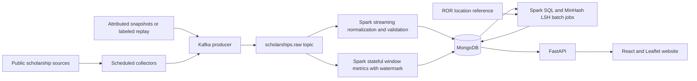

# Global Scholarship Map design

Status: approved by the user on 26 November 2026, with Arabic UI and the ScholarshipMap folder explicitly selected.

This document records the original design. Implementation and verification are documented in README.md and docs/verification.md. The user's subsequent request to replace the two-result sample supersedes the original narrow default and collection scope; see docs/superpowers/plans/2026-11-26-catalogue-expansion.md.

## Purpose and agreed decisions

Help a student answer: **Which scholarship opportunities fit my stated background, where could I study, and what do I need to check before applying?**

The user chose a custom website with React, Leaflet, and FastAPI. Students browse the map first. Personalization is optional and uses nationality, GPA, field of study, degree level, and preferred countries. The map and scholarship cards must work together, and a selected opportunity must link to its official application information.

The instructor approved the idea and specifically requested real data streaming and pages that help someone. The course brief also requires Kafka, Spark Structured Streaming with a stateful query, Spark SQL/batch processing, MongoDB, and one probabilistic structure evaluated against an exact method. Bloom filters are not specifically required; the user questioned their usefulness.

The supplied `Big_Data_Engineering_Course_Project_Fall2026_v2.docx`, sections 3.3 and 5, explicitly permits MinHash LSH, including Spark's built-in implementation, and replay of a static dataset through a real streaming pipeline. The brief sets no minimum dataset volume and values demonstrated scalability and measurable results over raw size. These points do not require asking the instructor again unless later feedback changes them. This design adds two live polling adapters as a project goal; replay supports their demonstration and does not replace that goal.

User-provided references are evidence and project requirements, not authorization to publish a repository, contact providers, create social accounts, or attribute work to teammates.

## Proposed defaults requiring review

- Project location: `C:/Users/pc/IdeaProjects/ScholarshipMap`, separate from the existing Scala exercise in `bigData`.
- Arabic interface with right-to-left layout, explicitly selected by the user. Discussion remains Arabic.
- Global nationality and destination fields, with an initial source selection that includes opportunities relevant to Palestinians. Do not label every imported scholarship Palestinian-eligible.
- Degree level means the degree the student wants funding to pursue. Field of study is likewise the intended study field.
- No account is needed for browsing or the initial personalization flow. Keep the profile in the current browser session; persistent accounts and saved opportunities are outside the first release.
- Python for collectors, PySpark jobs, and FastAPI. React with TypeScript for the frontend.
- Use MinHash LSH to find near-duplicate scholarship listings in batch processing. This replaces the proposed Bloom filter and remains a design proposal for user review.
- Begin with Scholarship Finder's public low-data pages and IEFA as collection candidates; add official-source adapters incrementally after testing their detail pages and access conditions.

## Goals and boundaries

Deliver an end-to-end system that collects real listings, detects source changes, streams events through Kafka and Spark, stores normalized data in MongoDB, and makes the results useful through the website.

Keep missing eligibility information visible. Preserve source provenance, application cycles, and deadline confidence. Measure the probabilistic method rather than assuming it is faster or more accurate.

The first release does not submit scholarship applications, predict admission probability, determine visa eligibility, offer a mobile app, or require email alerts. It does not promise complete global coverage or instant notification of an update made on an external website.

The project fails its purpose if map points are invented, profiles silently exclude opportunities because information is missing, expired listings are presented as open, the streaming path is only a visual animation, or benchmark results are fabricated.

## Approaches considered

| Approach | Tradeoff | Decision |
| --- | --- | --- |
| Custom React and Leaflet frontend with FastAPI | More interface work, with direct control of synchronized cards, filters, map selection, and scholarship details | Selected by the user |
| Streamlit data application | Quick Python-based interface; custom map and card behavior may require extra components | Discussed but not selected |

For data collection, use periodic public-source collection plus an explicit replay mode. Scholarship websites are checked periodically; a continuous Kafka consumer processes detected changes. Replay makes demonstrations repeatable while using the same real Kafka and Spark path. Replay and generated benchmark data must be labeled, never represented as newly discovered live opportunities.

## Student experience

### Explore page

The initial view contains a world map, a matching list of cards, search, and filters. No profile or login blocks browsing. Show country groups at low zoom and university/city groups when enough location information is available. Selecting a group filters or highlights its cards; selecting a card highlights its location.

Default discovery shows open, upcoming and clearly labeled unverified listings, prioritizing verified open calls. Closed opportunities remain in storage and are hidden from the default results. A separate verified-open filter is available. A missing or recurring deadline is not evidence that applications are open.

For the verified-open filter, confirmed open requires current official evidence that the specific application cycle is accepting applications, or verified official opening/closing dates that include the current date. An explicit official rolling-application statement also qualifies. An aggregator's future deadline alone does not. Recheck official evidence at collection time where a supported adapter exists; evidence older than seven days is shown as stale and moves out of the verified-open filter until rechecked. A source outage must not mark an award closed.

Every card includes title, destination when known, degree, funding category, application status, deadline confidence, and source. Use actual scholarship counts, not counts of duplicated source listings or map placements.

Count only identity-and-cycle-resolved canonical groups in the confirmed opportunity total. Listings with an unresolved identity or suspected duplicate relationship remain separately browsable in the needs-verification view and have an explicitly separate listing count. They do not inflate the headline count of confirmed opportunities. Similarity candidates do not require manual adjudication before they can be viewed, but they do require identity/cycle resolution before joining the confirmed count. Grouped markers may show both counts with distinct labels.

### Personalization panel

An optional panel accepts:

| Input | Meaning |
| --- | --- |
| Nationality | Citizenship used for explicit nationality rules; do not treat it as country of residence |
| GPA and its scale | Value plus 4, 5, 100, or another explicitly entered basis |
| Field of study | Intended field mapped to a small documented taxonomy |
| Degree level | Intended funded degree: bachelor, master, PhD, or an explicitly supported other level |
| Preferred countries | Ranking preference; a separate country filter can restrict results |

GPA scale is metadata for the GPA input, not an extra profile requirement. Some sources ask for percentage marks, completed qualifications, or different grade systems. Do not convert a 4-point GPA to a percentage by simple multiplication. Compare only a compatible basis or a provider-documented equivalence; otherwise report that the grade requirement needs checking.

Known contradictory nationality, degree, field, or comparable grade requirements exclude an opportunity from personalized matches. Missing requirements produce a potential match rather than an automatic rejection. Rank remaining results by field relevance and destination preference, with a documented initial weighting of 70% field and 30% destination. If no destination preference is entered, use field relevance alone. Use deadline and title only as deterministic tie-breakers, with unspecified deadlines last.

The numeric score measures similarity to preferences, not admission probability. Explain which inputs matched and which conditions need checking. The five fields cannot establish full eligibility for programs that also require age, residence, language tests, work experience, or an admission offer. Show those extra conditions without expanding the mandatory profile form.

### Scholarship details

Display official name, funding coverage, participating institutions, destinations, intended degrees/fields, the original eligibility text, normalized requirements, deadline and timezone when explicitly stated, application cycle, official link, and provenance.

Distinguish when we fetched a listing, when the source says it checked the listing, and when the official application details were actually verified. Fetching an aggregator today does not mean its scholarship deadline was verified today.

If sources disagree, display the uncertainty and prefer a verified official program page for the disputed fact. Preserve alternative source links. A government-wide scholarship must not be attached to an arbitrary university.

### Insights and source activity

A student-oriented insights view answers which destinations have opportunities matching the current filters, how funding categories compare, and which verified deadlines are approaching. Batch Spark SQL produces these results over stored data.

A separate compact source-activity view helps the team understand whether collection and streaming are current: last successful check, collection errors, processed observations by source/window, and latest Spark processing time. Technical details belong here, not in the student's eligibility form.

## Data sources and location enrichment

The assessed source register is in `docs/data-sources.md`. A readable page is a collection candidate, not a finished or authorized integration. No public scholarship API has been confirmed for the supplied sites.

Pilot priorities are Scholarship Finder's `/lite` index and detail pages, IEFA's public award index/details, and a small set of official program pages. ScholarPal is useful for discovery but includes estimated deadlines. DAAD is an official reference and a candidate for detail-page collection; direct collection of its search results still needs investigation. Mastersportal returned HTTP 403 in the direct access check and will remain reference-only unless a permitted access method becomes available. Facebook did not expose scholarship posts in the fetched page; use Amideast's official scholarship website instead.

Add Erasmus Mundus, Türkiye Scholarships, Chevening Palestine, the Bseisu Foundation, and selected university pages such as Goldsmiths as planned official sources. Adding a catalogue to the register does not assert every listed program is funded or currently open.

For university identity and geographic enrichment, use ROR records with matching name, country, and official website. ROR's geographic fields commonly represent the city, so label them as approximate city locations. Only use a campus-level marker when a separate reliable campus location has been recorded. Keep the coordinate source and precision.

Support one scholarship at multiple institutions/countries. Distinct placement markers link to the same scholarship ID; they must not inflate scholarship totals. Country-wide opportunities use a country-level representation. An opportunity with no reliable location remains in the list with a location-unknown label.

## System architecture

The browser retrieves updated results from FastAPI at a configurable interval, initially ten seconds. This browser refresh mechanism is separate from the real Kafka-to-Spark stream.

## Core data contracts

Source-specific records remain available even after canonical grouping. Store source IDs and URLs, provider record IDs, collection timestamps, content hashes, original eligibility text, extracted fields, field-level uncertainty, and official application links.

A canonical scholarship represents a named funding opportunity in a specific application cycle. It contains:

- Stable ID, title, provider, cycle identifier or explicitly unknown cycle, source record links, and version information.
- Destination country codes and zero or more institution placements, each with identity, coordinates, precision, and evidence.
- Degrees, field taxonomy tags, funding category, explicitly stated nationality restrictions/exceptions, compatible grade thresholds, and extra eligibility requirements.
- Application status, exact date/time when available, date-only precision when applicable, timezone when supplied, and deadline confidence: confirmed, estimated, recurring, or unknown.
- `fetched_at`, `source_checked_at`, `official_verified_at`, `changed_at`, and the origin of each normalized value.

MongoDB collections are proposed as `source_records`, `scholarships`, `ingest_events`, `invalid_events`, `source_runs`, `stream_windows`, `near_duplicate_candidates`, `insights`, and `benchmark_runs`. Use a unique canonical ID and a unique source/provider-record/cycle key where cycle is known. Keep ambiguous cycles separate until identified.

## Collection and streaming behavior

1. Check source policies and the public page format before enabling an adapter. Respect published restrictions and rate limits. A robots allowance is not a data license or API contract. Do not bypass logins, bot blocks, or TLS checks.
2. Start with a configurable six-hour collection interval, one concurrent request per host, timeouts, retries with backoff, and conditional requests when supported. Adjust an individual source to its published requirements.
3. Emit `discovered`, `updated`, or explicitly evidenced `closed` events when normalized source content changes. Do not close a scholarship merely because a fetch failed or it disappeared from a partial index.
4. Each Kafka JSON message has a schema version, deterministic event ID, source record ID, event type, `observed_at` in UTC, source URL, content version/hash, and the minimum raw fields needed for provenance. Kafka is mandatory, not an optional shortcut.
5. Use a single-node Kafka KRaft setup for local development, with durable volumes and explicit topic retention. Development replication does not claim cluster fault tolerance.
6. The ingestion query validates and normalizes messages, sends malformed records to `invalid_events`, and uses `foreachBatch` for idempotent MongoDB writes. Deduplicate exact event IDs and preserve the most recent valid version of a record. Reprocessing a batch must not create duplicate scholarship records or overwrite a newer version with an older event.
7. A separate query reads Kafka, uses `observed_at` as event time, and counts valid source observations by five-minute window, source, and event type with a ten-minute watermark. Write updating window counts to deterministic MongoDB keys. Label these as observation/message counts, not counts of unique scholarships.
8. Watermarks bound the aggregation state. An event too late for the metrics window can still update the catalogue through the separate ingestion query if it is the newest valid record version. Record late-event metrics.
9. Persist query checkpoints independently on durable storage. MongoDB sinks are designed for retry safety; do not claim a distributed exactly-once transaction between Kafka and MongoDB.

The producer's timestamp records when the change was observed, not when a scholarship was first created on an external website. Deadline timestamps are distinct from event time.

Replay consumes attributed snapshot records and follows the same topic, jobs, and sinks. It has a run ID, explicit replay mode, deterministic IDs within a run, configurable rate, and labeled demonstration timestamps. Keep demo data in a separate database/topic namespace from normal collection. Demonstrate duplicates, an update, out-of-order arrival, and an invalid record without presenting injected events as real source changes.

## Spark batch processing and probabilistic component

Run Spark SQL over the MongoDB scholarship data to compute verified upcoming deadlines, counts by destination and degree, funding distribution, source completeness, and the input datasets for location enrichment and near-duplicate detection. Batch work runs after the initial import and then on a documented schedule, initially every fifteen minutes during a demo or on demand.

Use Spark ML `MinHashLSH` to generate candidates for listings that describe the same scholarship in different wording across sources. Exact event deduplication in streaming remains separate from approximate cross-source similarity.

Normalize titles/provider names/descriptions and create nonempty token/shingle sets. Preserve original text, application year, institution identifiers, and cycle. Fit a deterministic model with a documented seed. Compare an initial sweep of 4, 8, 16, and 32 hash tables and Jaccard similarity thresholds of 0.65 and 0.80. Final parameters depend on measured recall, memory, and runtime.

Use exact raw-set Jaccard similarity to check candidate pairs after LSH. Shared verified official program identity and cycle can justify canonical grouping. Similar wording alone creates a candidate relationship, not automatic destructive merging. Do not merge different application cycles or separate awards solely because their titles look alike. Exclude empty feature vectors and report their count.

Evaluate on a bounded real-listing sample with manually labeled duplicate/nonduplicate pairs, plus clearly labeled generated variants and larger benchmark workloads. On the same inputs and similarity thresholds, compare against exhaustive exact pairwise Jaccard. Report candidate recall, precision, false positives/negatives, any signature-based similarity error if implemented, index/signature memory, feature storage, peak process/JVM memory, and end-to-end elapsed time including preprocessing and index construction. Distinguish algorithm memory from Spark runtime overhead.

Start exact comparisons at 100, 250, 500, and 1,000 records where available; benchmark-generated records are reported separately from genuine scholarship counts. Publish actual runtime results even if the exact method wins at this scale. The small real corpus must not be advertised as millions of scholarships.

Official technical references: [Spark MinHashLSH](https://spark.apache.org/docs/latest/api/python/reference/api/pyspark.ml.feature.MinHashLSH.html), [ROR API](https://ror.readme.io/docs/rest-api), and [ROR geography](https://ror.readme.io/docs/schema-v2-1).

## API and frontend boundary

FastAPI reads MongoDB for catalogue requests; page loads do not start a Spark job. Proposed endpoints provide paginated scholarships, a scholarship detail, map groups/placements, filter metadata, personalized recommendations, batch insights, source activity, and readiness/health status.

Map and list endpoints share the same filter and canonical-ID semantics. The map query uses bounds and zoom to return a suitable number of groups. Display exact filtered programme counts with clear placement counts where needed. Never truncate silently and then label the returned marker count as the full result total.

FastAPI validates GPA ranges against the supplied scale and accepts profile fields in a request body. There is no need to send profile information to scholarship providers. Use Leaflet with an attributed map tile provider under its usage policy; tile access and any API-key requirement must be resolved before the runnable implementation is finalized.

## Local development and delivery

Read-only machine checks found approximately 15.8 GB RAM and 12 logical processors. Docker was not found on PATH; no software was installed. Plan a lightweight local configuration: one Kafka broker, one MongoDB instance, Spark local mode with two execution threads, FastAPI, and a frontend development server. Validate the Docker/WSL setup and memory budget before implementation acceptance.

The builder chooses maintained mutually compatible versions of Spark, Java, Kafka integration packages, the MongoDB Spark connector, Python, Node, React, and Leaflet after checking their official compatibility documentation. Pin the versions in the implementation. Do not reuse the existing Scala exercise's Spark dependency without checking that matrix.

Proposed repository areas, to create only after design approval, are `frontend`, `backend`, `collectors`, `spark`, `data`, `benchmarks`, `infra`, and `docs`. Provide setup instructions, attributed sample data, environment examples without secrets, and commands for collection, replay, streaming, batch processing, and the website.

Prepare the course deliverables from actual results: architecture diagram, report of six to ten pages, a demo video of at most five minutes, and presentation material. Record actual contributions and AI assistance. Publishing a repository or impersonating member commits is not authorized by this design.

## Acceptance evidence

- A student can browse a map and list without a profile, select an institution/country, inspect details, and open the correct official page.
- The five-field form produces explained recommendations; incompatible known conditions are excluded, missing data stays visibly uncertain, and GPA bases are not naively converted.
- At least two automatic adapters collect genuine sources on the documented schedule and detect observed changes. Attributed imports and replay support tests and the demo; they do not replace the proposed two-adapter completion goal. Report actual record counts and known coverage limits.
- A real Kafka message passes through Spark into MongoDB and becomes visible through FastAPI and the website. Target a locally measured event-to-website latency below thirty seconds after ingestion; external source polling time is reported separately.
- A changed deadline updates an existing opportunity rather than creating a new scholarship. Repeated events and replaying a processed batch do not create duplicate catalogue records.
- A stateful window with a watermark produces stored results. Out-of-order and late arrivals demonstrate the documented difference between metrics and catalogue updates.
- Spark SQL batch queries produce the student insights from stored data, and the probabilistic benchmark is reproducible with exact baselines, declared parameters, error, memory, and time.
- Source outages, unknown deadlines, uncertain locations, invalid messages, and application-cycle differences are exercised with clearly labeled fixtures.
- Responsive map/list selection and filters are checked in a browser. The runnable environment, build checks, and relevant automated tests pass before completion is claimed.

## Decisions left to the builder

Choose the detailed visual design, component library, exact API names, internal modules, connector versions, compatible map tile provider, source-specific parsing selectors, and test fixtures within the above contracts. Treat blocked sources as unavailable until evidence changes. Preserve the source register when an adapter is activated or disabled.

The user approved implementation in the ScholarshipMap folder with an Arabic interface. Implementation is authorized; fabricated member contributions remain outside scope.

## Latest explicit map and preview instructions

The user's follow-up supersedes earlier world-polygon presentation: start with count tags at actual country reference positions and no polygon overlay. Clicking a country tag draws only that country's purple outline and zooms to known universities. Nearby tags appear with zoom, without displacing them into other countries. Actual server-owned addition/update/first-stream timestamps and a heartbeat-backed event page show ingestion. Six adapters now collect359 source listings in the frozen snapshot. The user selected a free temporary public link; Pinggy provides a browser-verified60-minute HTTPS session while the local machine and services run. This is not an independently hosted permanent deployment.
